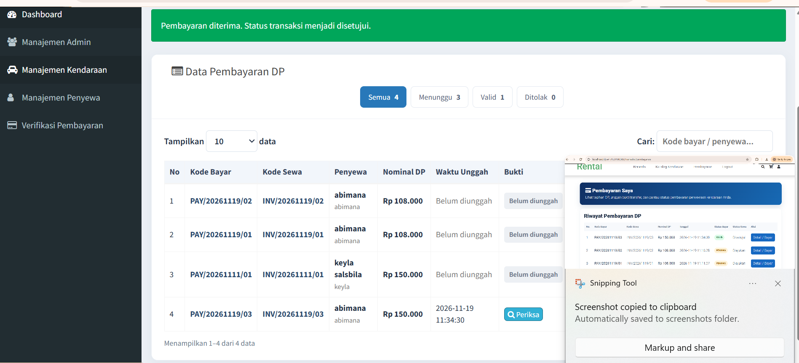
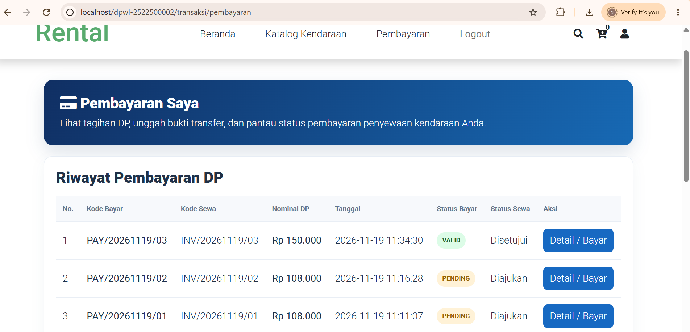

# pertemuan-09
# pertem### Gambar 1. 

### Gambar 2. 

# DPWL – Pengembangan Praktikum P9

## Fitur P9

Pengembangan ini melanjutkan aplikasi P7 yang sudah memiliki katalog, autentikasi, keranjang, checkout, dan pencatatan DP. P9 menambahkan:

- Halaman pembayaran DP untuk penyewa melalui `transaksi/pembayaran?kode_sewa={kode_sewa}`.
- Upload bukti transfer JPG/PNG/WEBP maksimal 3 MB ke `uploads/bayar/`.
- Penyimpanan nama file acak dan pemeriksaan MIME menggunakan PHP Fileinfo.
- Daftar verifikasi pembayaran pada `admin/verifikasi-pembayaran`.
- Tindakan admin menerima (`valid` / `disetujui`) atau menolak (`invalid` / `ditolak`).
- Pembaruan status pembayaran dan transaksi dalam satu transaksi database.
- Pemeriksaan sesi, kepemilikan transaksi, token CSRF, prepared statement, dan pola Post-Redirect-Get pada proses P9.

## File yang ditambahkan

- `application/models/Pembayaran_model.php`
- `application/controllers/Pembayaran_controller.php`
- `application/views/transaksi/pembayaran.php`
- `application/views/admin/verifikasi_pembayaran.php`
- `uploads/bayar/.htaccess`

## File yang diubah

- `application/config/routes.php` – route pembayaran, upload, bukti, dan verifikasi.
- `application/controllers/Transaksi_controller.php` – setelah checkout diarahkan ke halaman pembayaran DP.
- `application/views/templates/sidebar.php` – menu Verifikasi Pembayaran untuk admin.

## Persiapan dan menjalankan

1. Salin folder aplikasi ke `C:\laragon\www\dpwl-2522500002` atau folder web Laragon yang digunakan.
2. Pastikan konfigurasi `application/config/config.php` sesuai alamat folder aplikasi.
3. Pastikan koneksi `application/config/database.php` menunjuk ke database `db_dpwl_naufal` atau sesuaikan nama database lokal.
4. Import database P7 yang digunakan sebelumnya. Pengembangan P9 ini tidak membuat ulang database dan tidak menambahkan tabel.
5. Pastikan tabel `t_sewa`, `t_bayar`, dan `t_penyewa` memiliki kolom yang dipakai aplikasi. Khusus transaksi verifikasi, pastikan tabel `t_bayar` dan `t_sewa` menggunakan engine transaksional InnoDB agar `begin_transaction`, `commit`, dan `rollback` berlaku.
6. Pastikan ekstensi PHP `fileinfo` aktif.
7. Pastikan Apache rewrite aktif karena aplikasi memakai URL tanpa `index.php`.
8. Jalankan Apache dan MySQL dari Laragon, lalu buka alamat dasar aplikasi.

## Alur pembayaran

1. Penyewa login dan memilih kendaraan.
2. Penyewa mengatur keranjang lalu melakukan checkout.
3. Checkout P7 membuat satu record DP 30% pada `t_bayar` dengan `sttus_byr='pending'`. P9 tidak membuat record DP baru.
4. Setelah checkout, penyewa diarahkan ke halaman pembayaran transaksi tersebut.
5. Penyewa mengunggah bukti. Sistem memeriksa error upload, ukuran, MIME aktual, dan gambar, lalu menyimpan file ke `uploads/bayar/`.
6. P9 memperbarui `ft_byr` dan `tgl_wkt_byr`; status tetap `pending`.
7. Admin membuka menu Verifikasi Pembayaran dan memeriksa bukti.
8. Admin memilih terima atau tolak. P9 memperbarui `t_bayar.sttus_byr`, `t_bayar.tgl_wkt_ver`, dan `t_sewa.status_sewa` dalam satu transaksi database.
